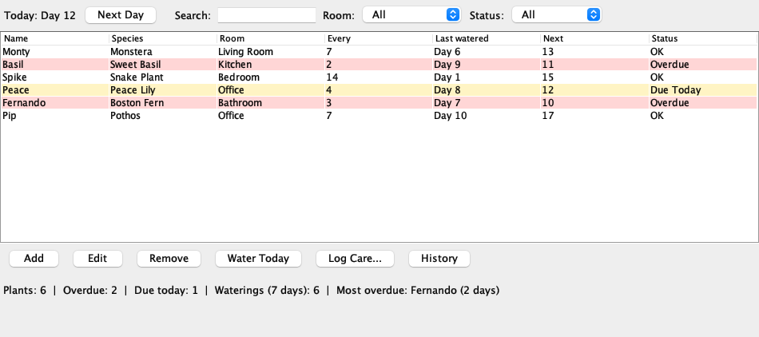

# Sprout — Plant Care Tracker

A Java Swing app that tracks houseplants, their care history, and which ones need water today.
*(Instructor example project for CSC110. A Dealer's Choice idea built by following the starter packet.)*

## How to run
Requires Java 21 or newer.
- **Windows:** double-click `run.bat`
- **Mac / Linux:** `bash run.sh`
- **Tests:** `test.bat` or `bash test.sh`

On first launch it loads `data/sample-garden.txt`. Your changes auto-save to `data/garden.txt` (delete it to reset).

## Features
- Add, edit, and remove plants, with validation (unique names, intervals of 1–60 days, no future days)
- Water Today and Log Care (water / fertilize / repot) with a history per plant
- Search by name, and filter by room and status (Overdue / Due Today / OK), with colored rows
- Summary: total, overdue, due today, waterings in the last 7 days, most overdue plant
- Simulated days (Next Day button) and auto-save

## Project documents
- [Proposal](docs/01-proposal.md) · [Plan](docs/02-project-plan.md) · [Class design](docs/03-class-design.md) · [UI prototype](docs/04-ui-prototype.md)
- [Final write-up](docs/final-writeup.md) · [Concept map](docs/concept-map.md) · [Steering log](docs/steering-log.md) · [Demo script](docs/demo-script.md)

Built for CSC110 with Claude Code as a pair programmer.
