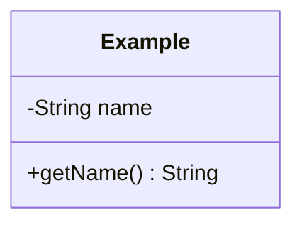

# Class Design (Data Design)
<!-- Fill with /class-design. Due Mon Nov 30. Keep this TRUE as the code changes: Claude reads it before every feature. -->

## Big picture
<!-- 2-3 sentences: which class holds what, and how the UI talks to the model. -->

## Class diagram


## Classes
<!-- One section per class. Model classes never import Swing. -->
### `ClassName` — model | manager | file store | UI
**Responsibility:**

| Fields (all private) | Type | Meaning |
|---|---|---|
| | | |

| Method | Purpose |
|---|---|
| `ClassName(...)` constructor | |

**CSC110 concepts shown:**

## Where the rules live
| Rule | Class.method |
|---|---|
| | |

## Save file format
<!-- File name(s) in data/, one record per line, fields separated by | . Show 2-3 example lines. -->
```
```
