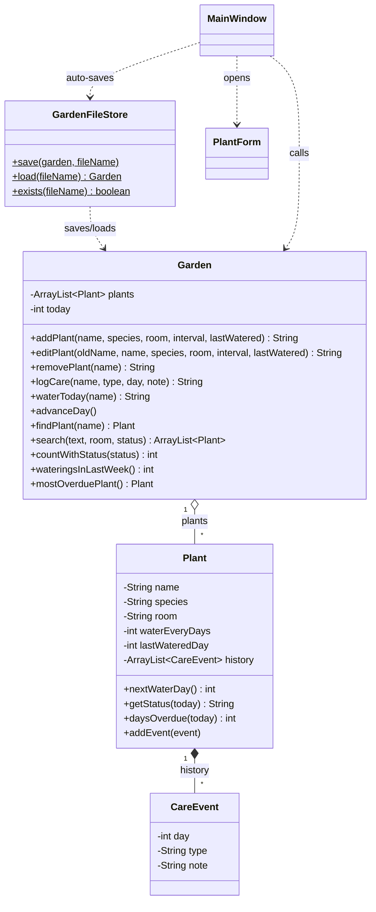

# Class Design (Data Design)

## Big picture
`Garden` is the manager: it owns the list of `Plant`s and the current Day, and it enforces every rule. Each `Plant`
owns its own list of `CareEvent`s, so deleting a plant deletes its history and renaming keeps it. `GardenFileStore`
turns a `Garden` into lines of text and back. The UI (`MainWindow`, `PlantForm`) only calls `Garden` methods and
shows the results. No model class imports Swing.

## Class diagram


## Classes

### `CareEvent` (model)
**Responsibility:** one thing done to a plant on a day.

| Fields (all private) | Type | Meaning |
|---|---|---|
| `day` | `int` | Day it happened |
| `type` | `String` | `WATER`, `FERTILIZE`, or `REPOT` (String constants) |
| `note` | `String` | optional, may be `""` |

| Method | Purpose |
|---|---|
| `CareEvent(int day, String type, String note)` | constructor |
| getters, `toString()` | e.g. `Day 10 – Water (soaked)` |

**CSC110 concepts shown:** class, constructor, private fields, getters, `toString`, `static final` constants.

### `Plant` (model)
**Responsibility:** one plant's info plus its care history, and the math for when it needs water.

| Fields (all private) | Type | Meaning |
|---|---|---|
| `name`, `species`, `room` | `String` | basic info |
| `waterEveryDays` | `int` | watering interval |
| `lastWateredDay` | `int` | last Day it got water |
| `history` | `ArrayList<CareEvent>` | its care events |

| Method | Purpose |
|---|---|
| `Plant(name, species, room, waterEveryDays, lastWateredDay)` | constructor, empty history |
| `nextWaterDay()` | `lastWateredDay + waterEveryDays` |
| `getStatus(int today)` | `OVERDUE` / `DUE_TODAY` / `OK` |
| `daysOverdue(int today)` | 0 if not overdue |
| `addEvent(CareEvent e)` | adds to history; a later Water event moves `lastWateredDay` forward |
| setters for name/species/room/interval/lastWatered | used by `Garden.editPlant` **after** it validates |

**CSC110 concepts shown:** encapsulation, `ArrayList` field, methods with parameters and returns, `if/else`.

### `Garden` (manager)
**Responsibility:** owns all plants and the current day; **every rule lives here.**
Mutating methods return `Garden.OK` or an error message the UI can show.

| Fields (all private) | Type | Meaning |
|---|---|---|
| `plants` | `ArrayList<Plant>` | all plants, in the order added |
| `today` | `int` | current Day (starts at 1) |

| Method | Purpose |
|---|---|
| `addPlant(...)` / `editPlant(oldName, ...)` | validate, then add/update |
| `removePlant(name)` | removes the plant (and therefore its history) |
| `logCare(name, type, day, note)` / `waterToday(name)` | validate, then `plant.addEvent(...)` |
| `advanceDay()` | `today++` |
| `findPlant(name)` | loop, `equalsIgnoreCase`; `null` if missing |
| `search(text, room, status)` | builds a new filtered list (`""` or `ALL` means "no filter") |
| `countWithStatus(status)`, `wateringsInLastWeek()`, `mostOverduePlant()`, `getRooms()` | summary math |
| `validatePlant(...)` (private) | shared by add and edit |

**CSC110 concepts shown:** `ArrayList` traversal, searching, filtering into a new list, accumulators, validation with `if`.

### `GardenFileStore` (file store)
**Responsibility:** save a `Garden` to a text file and load it back (`save`, `load`, `exists`). Static methods. Loading skips broken lines instead of crashing. `// BEYOND CSC110:` file I/O + try/catch.

### `MainWindow` (UI) and `PlantForm` (UI)
`MainWindow` is the `JFrame`: top bar (Day, Next Day, search, filters), plant table, buttons, summary bar, status
line. After every change it refreshes the table and summary and auto-saves. `PlantForm` is the add/edit form shown in
a dialog; `PlantForm.readNumber` turns non-numbers into -1 so `Garden` rejects them. `// BEYOND CSC110:` Swing.

## Where the rules live
| Rule | Class.method |
|---|---|
| Name required, ≤ 30 chars, no `\|`, unique ignoring case | `Garden.validatePlant` |
| Interval 1–60, last watered between 1 and today | `Garden.validatePlant` |
| Event day between 1 and today; plant must exist; valid type | `Garden.logCare` |
| Watering moves last-watered forward only | `Plant.addEvent` |
| Status / days overdue | `Plant.getStatus`, `Plant.daysOverdue` |
| Removing a plant removes its history | `Garden.removePlant` (history lives inside the plant) |
| Summary counts each plant/event once | `Garden.countWithStatus`, `Garden.wateringsInLastWeek` |

## Save file format
`data/garden.txt` (sample: `data/sample-garden.txt`). One record per line, fields separated by `|`.
Events come right after the plant they belong to.
```
TODAY|12
PLANT|Monty|Monstera|Living Room|7|6
EVENT|6|Water|soaked it
EVENT|8|Fertilize|
PLANT|Spike|Snake Plant|Bedroom|14|1
```
