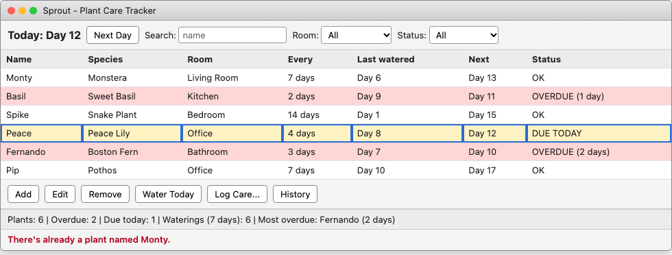

# UI Prototype
<!-- Fill with /ui-prototype. Due Mon Nov 30. The clickable prototype is docs/prototype/index.html (open it in a browser). -->

**Open the prototype:** `docs/prototype/index.html`

## Screens
<!-- One line per screen/tab/dialog: what's on it, and which requirements it covers. -->
| Screen | What's on it | Requirements |
|---|---|---|
| | | |

## Navigation flow
<!-- e.g. Main → [Add] → Add form → [Save] → back to Main (list updates) -->
-

## Errors and messages
<!-- Where do error messages appear? Status bar, pop-up, red label? List the exact messages. -->

## Screenshots
<!-- Save 1–2 screenshots in docs/images/ and link them:  -->

## What I found clicking through
<!-- In your words: what was missing, confusing, or wrong, and what you changed in the plan or class design. -->
-
