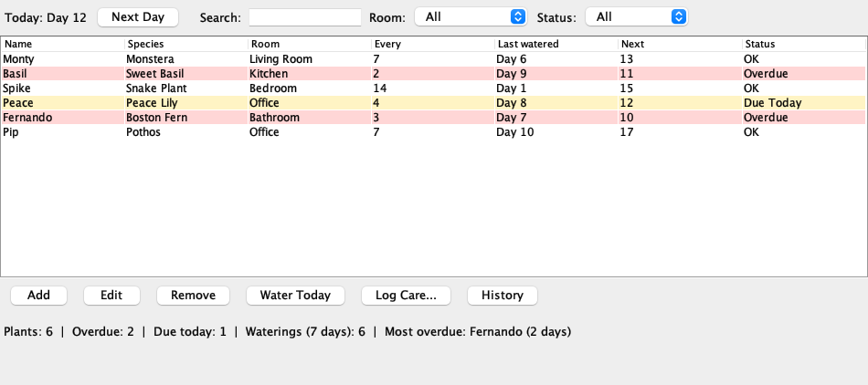

# Final Write-up

**Name:** Example Student (instructor example) · **Project:** Dealer's Choice: Sprout, Plant Care Tracker · **Repo:** _(link)_

## 1. Overview
Sprout is a desktop app for people with lots of houseplants. You add your plants with how often they need water,
log care (water, fertilize, repot), and Sprout shows which plants are overdue or due today, with a summary across your
whole collection. Time is a simulated "Day N" counter with a Next Day button, so it's easy to demo.

## 2. Requirements and how I met them
| Requirement | How it's met | How to test it |
|---|---|---|
| Add, edit, remove plants | Add/Edit/Remove buttons → `Garden.addPlant / editPlant / removePlant` | Checklist #2, #5, #11 |
| Reject bad plant input | `Garden.validatePlant` (blank, >30 chars, `\|`, duplicate ignoring case, interval 1–60, last watered 1..today) | #3, #4 |
| Log care; watering updates last-watered | Water Today + Log Care → `Garden.logCare` → `Plant.addEvent` (moves forward only) | #6, #7 |
| Remove deletes history; rename keeps it | History is stored inside each `Plant` | #5, #11 |
| Search + room + status filters | `Garden.search(text, room, status)` | #8, #9 |
| Summary that updates | `countWithStatus`, `wateringsInLastWeek`, `mostOverduePlant`, refreshed after every change | #6, #10 |
| Save and reopen everything | Auto-save to `data/garden.txt` after every change; `GardenFileStore.load` on start | #12 |

## 3. Architecture
`Garden` (manager) owns an `ArrayList<Plant>` and the current day, and holds every rule. Each `Plant` owns an
`ArrayList<CareEvent>`. `GardenFileStore` saves and loads text. `MainWindow` and `PlantForm` are the Swing UI and only
call `Garden`. Full diagram: [03-class-design.md](03-class-design.md).

**Changes from the design:** I added `GardenFileStore.exists()` (to decide when to load the sample data) and
`PlantForm.readNumber()` (turns "abc" into −1 so `Garden` rejects it with a normal message). Loading now skips
broken lines instead of crashing.

## 4. How to run
- **Windows:** double-click `run.bat` · **Mac:** `bash run.sh` · Requires Java 21+
- **Sample data:** if `data/garden.txt` doesn't exist, the app loads `data/sample-garden.txt` (Day 12, 6 plants, 2 overdue).
  To reset, delete `data/garden.txt`.

## 5. Testing
JUnit (`bash test.sh`), 9 tests plus the setup check:
- `GardenTest`: `rejectsDuplicateNameIgnoringCase`, `rejectsIntervalOutsideRangeAndFutureLastWatered`,
  `editingKeepsHistoryAndStillBlocksDuplicates`, `wateringFixesOverdueAndCountsInSummary`,
  `rejectsCareForMissingPlantOrFutureDay`, `oldWateringDoesNotMoveLastWateredBackward`,
  `mostOverduePicksLargestAndRemoveDeletesPlant`
- `GardenFileStoreTest`: `saveThenLoadRestoresEverything`, `sampleFileLoads`

Manual checklist: all 12 checks in [02-project-plan.md](02-project-plan.md) pass.

## 6. Known issues / not finished
- No undo for care events (a "Could" item).
- Table columns can't be sorted by clicking headers.
- Typing a non-number in a number box shows the range message ("must be 1-60 days") rather than "please type a number."

## 7. Concept connections
See [concept-map.md](concept-map.md). Top 3: classes & objects (one home per rule), `if/else` validation in
`validatePlant`, and the loop-and-filter pattern in `search`.

## 8. How I steered Claude (YOU)
_Example of the kind of thing students write. Taken from [steering-log.md](steering-log.md):_
- Claude's first design kept all care events in one big list matched by plant name. I asked what happens on rename,
  and we moved history into each `Plant`. Rename and delete "just work" now.
- Claude's watering logic would have moved "last watered" backward when I logged an old watering. I described the
  case, and we added a rule and a test.
- Claude put validation in the form. I reminded it our design says rules live in `Garden`, so the UI can't skip them.

## 9. What I learned (YOU)
_Student writes this in their own words._

## 10. With one more week I would... (YOU)
_Student writes this in their own words._
